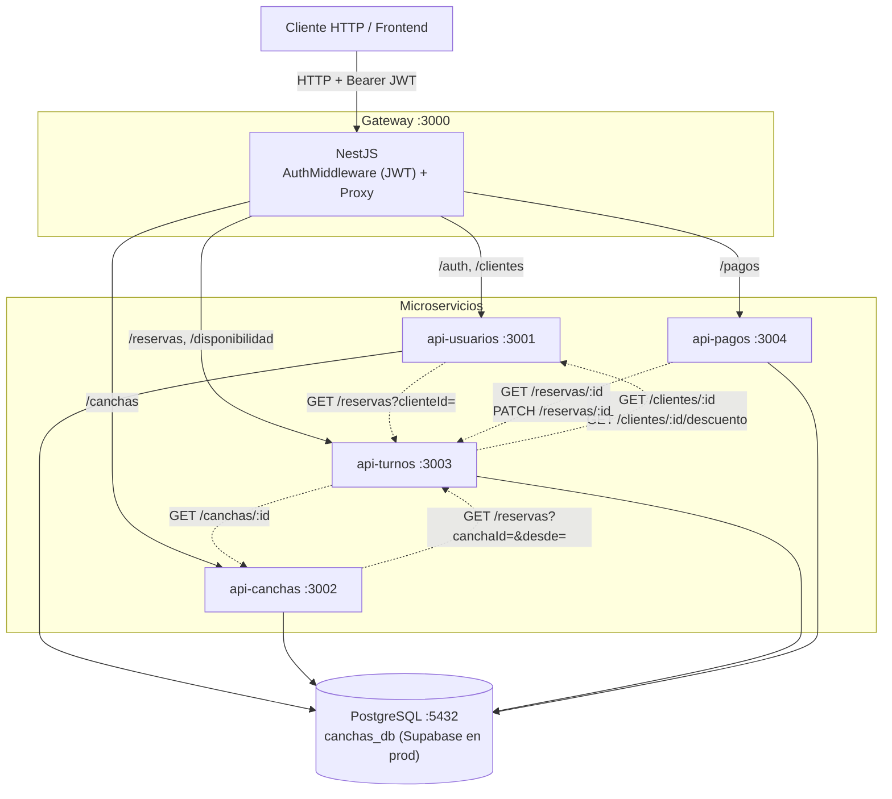
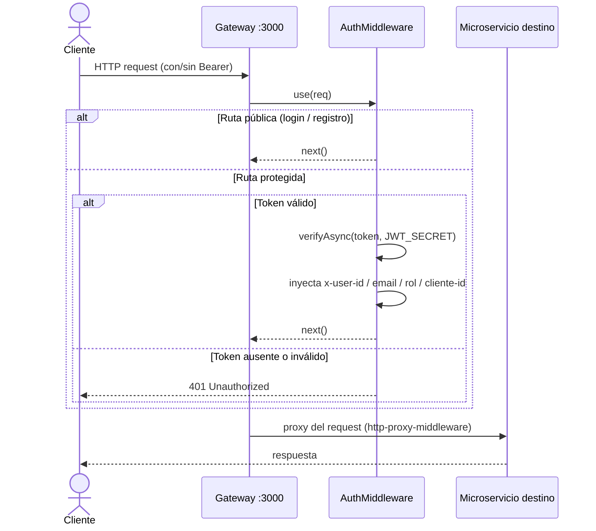
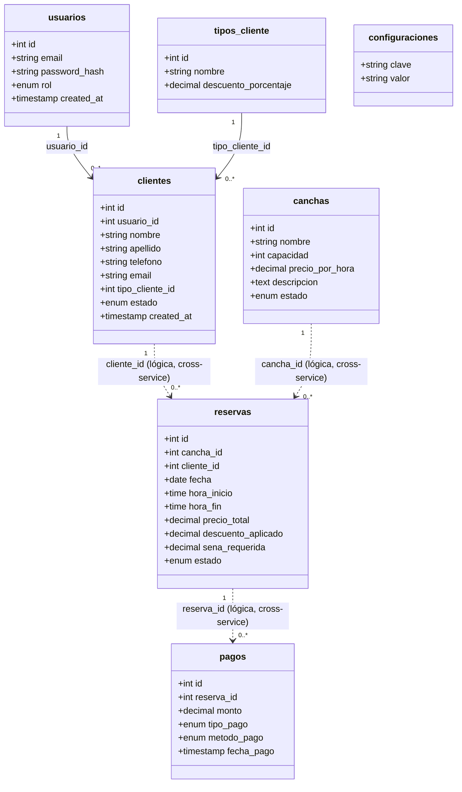

# Documentación — Sistema de Reservas de Canchas de Fútbol

## Diagrama de arquitectura de alto nivel

- **Flechas sólidas:** ruteo del gateway (síncrono, request del cliente).
- **Flechas punteadas:** comunicación interna entre microservicios (HTTP directo, **sin** pasar por
  el gateway).

## Gateway — ruteo y seguridad

El `ProxyController` (`@All('*')`) reenvía cada request al microservicio según el prefijo del path:

| Prefijo de URL | Microservicio destino | Variable de entorno |
|----------------|-----------------------|---------------------|
| `/auth`, `/clientes` | api-usuarios :3001 | `USUARIOS_URL` |
| `/canchas` | api-canchas :3002 | `CANCHAS_URL` |
| `/reservas`, `/disponibilidad` | api-turnos :3003 | `TURNOS_URL` |
| `/pagos` | api-pagos :3004 | `PAGOS_URL` |

`AuthMiddleware` se ejecuta **antes** del proxy:

- **Rutas públicas** (sin token): `POST /auth/login`, `POST /auth/registro`, `GET /canchas`
  (catálogo público para que la home liste canchas sin estar logueado).
- Resto: exige header `Authorization: Bearer <jwt>`, valida con `JWT_SECRET` e inyecta
  `x-user-id`, `x-user-email`, `x-user-rol` y `x-cliente-id` en la request reenviada. El
  `x-cliente-id` sale del token verificado y **sobreescribe** cualquier valor entrante, de modo
  que un cliente no pueda falsificarlo.

> **Defensa en profundidad — `x-internal-secret`:** además del JWT, el gateway inyecta en cada
> request proxeada el header `x-internal-secret` (valor de `INTERNAL_SECRET`, idéntico en gateway y
> microservicios). Cada microservicio tiene un `InternalAuthGuard` global que responde **403** a
> toda request que no traiga ese secreto, de modo que nadie pueda pegarle directo a la URL pública
> del microservicio salteándose el gateway (y su validación de JWT). El gateway borra cualquier
> `x-internal-secret` entrante del cliente antes de inyectar el suyo, igual que con `x-cliente-id`.
> Las llamadas internas entre microservicios también lo mandan. **Exentos del guard:** el preflight
> `OPTIONS` (CORS) y `GET /health` (health check de Render, que pega directo al microservicio).

> **Scope por dueño:** api-turnos usa `x-user-rol` + `x-cliente-id` para que un cliente solo vea y
> opere **sus** reservas. En `GET /reservas` fuerza el filtro `clienteId` con el del token (ignora
> el de la query); en `GET/PATCH/DELETE /reservas/:id` responde **403** si la reserva no es suya.
> Un `admin` (sin `cliente_id` en el token) no tiene esta restricción.

## Manejo de errores y códigos de estado

Cada microservicio tiene un **exception filter global** (`AllExceptionsFilter`) que normaliza toda
respuesta de error a `{ statusCode, error, message }` y evita que un error de base de datos se
escape como `500`: traduce los códigos de PostgreSQL al HTTP correcto.

| Origen | HTTP |
|--------|------|
| `HttpException` de NestJS (`NotFound`, `Forbidden`, validación, etc.) | su código (404 / 403 / 400 …) |
| Request sin `x-internal-secret` válido (no pasó por el gateway) | **403** |
| Conflicto de estado: borrar/inactivar un recurso con dependencias activas | **409** |
| PG `23505` (único duplicado) | **409** |
| PG `23503` / `23502` / `23514` / `22P02` / `22007` (FK, not-null, check, formato) | **400** |
| Dependencia cross-service no responde (verificación obligatoria) | **503** |
| Error inesperado del servidor | **500** (se loguea con stack) |

En el **gateway**: microservicio caído → **502**; token ausente/inválido → **401**; ruta sin match
→ **404**. Los códigos que devuelven los microservicios se reenvían tal cual al cliente.

> **Conflictos `409` (integridad cross-service).** Como no hay FK entre tablas de distintos
> servicios, la integridad referencial a futuro se valida por HTTP y se rechaza con **409**:
> `DELETE /clientes/:id` con reservas asociadas, `DELETE /canchas/:id` y `PATCH /canchas/:id`
> (a `mantenimiento`/`fuera_servicio`) con reservas activas a futuro. Si el servicio dueño de las
> reservas (api-turnos) no responde durante la verificación, la operación se aborta con **503**.

## Modelo de datos (alto nivel)

Una sola base PostgreSQL (`canchas_db`) compartida (Supabase en producción); cada microservicio es **dueño** de sus tablas.
No hay FK entre tablas de distintos servicios (acoplamiento débil); las relaciones cross-service se
resuelven por HTTP.

### Principio de diseño: un único dueño por dato (derivar, no duplicar)

- **Estadísticas del cliente** (`noShows`, `totalReservas`, `ultimaReserva`) **no se almacenan**:
  se derivan de las reservas (api-turnos). Se consultan vía `GET /clientes/:id/estadisticas`.
- **Estado de pago de una reserva** (seña pagada, saldo): **no se almacena** en la reserva; se
  deriva de los pagos (api-pagos). Se consulta vía `GET /pagos?reservaId=`.
- **Auto-bloqueo por no-shows**: lo evalúa api-turnos al crear una reserva (`validarCliente`),
  contra el parámetro `max_no_shows_bloqueo` de `configuraciones`.

## Parámetros de negocio 

| Clave | Default | Uso |
|-------|---------|-----|
| `sena_porcentaje` | 30 | % de seña sobre el precio total |
| `max_no_shows_bloqueo` | 3 | No-shows que bloquean a un cliente |
| `horas_anticipacion_min` | 2 | Anticipación mínima para reservar |
| `duracion_maxima_horas` | 3 | Duración máxima de una reserva |
