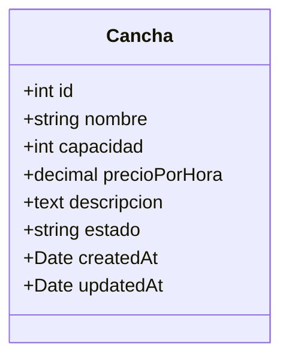
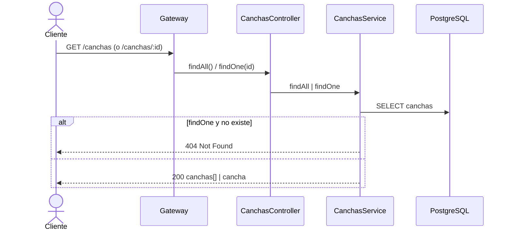
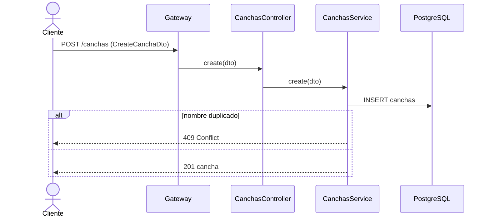
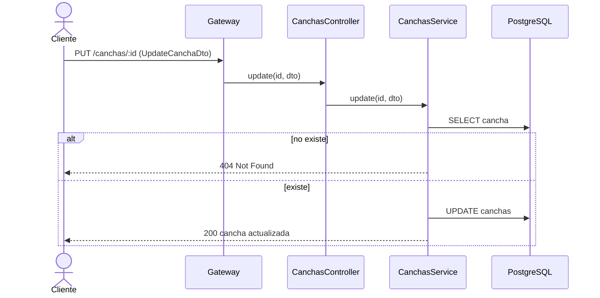
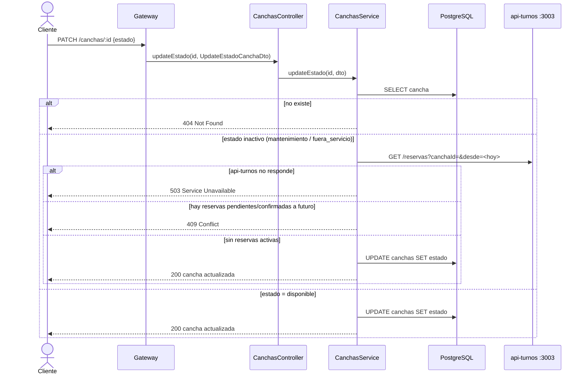
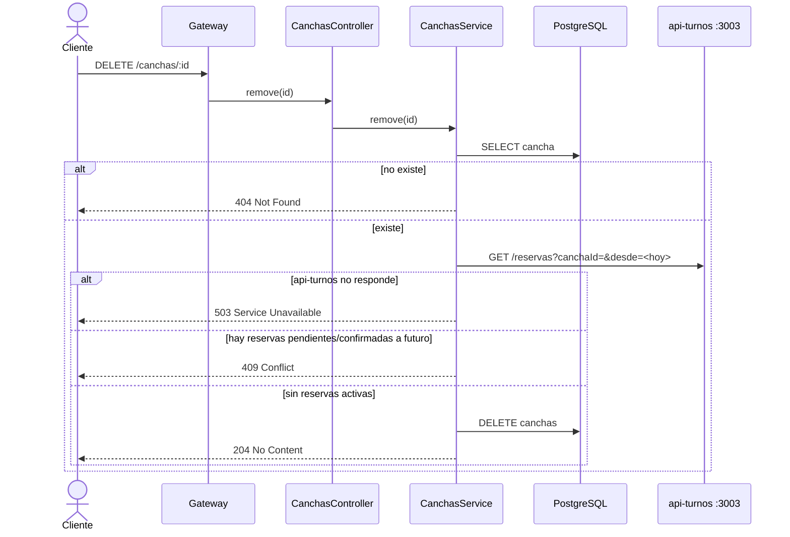

# api-canchas :3002

Microservicio de **gestión de canchas**.

- Base de datos: tabla `canchas`.
- Dependencia saliente: `api-turnos` (verificar reservas activas antes de inactivar/eliminar una cancha).
- Variables de entorno: `PORT`, `DATABASE_URL`, `TURNOS_URL`, `INTERNAL_SECRET`.
- Seguridad: `InternalAuthGuard` global → **403** si la request no trae `x-internal-secret` (no pasó
  por el gateway). Exentos: `OPTIONS` y `GET /health` (health check de Render → `{ status: 'ok' }`).

## Entidad

- `nombre` es único; `capacidad` por defecto 22.
- `Cancha.estado`: `disponible` · `mantenimiento` · `fuera_servicio`

## Endpoints

| Método | URL | Éxito | Descripción |
|--------|-----|-------|-------------|
| GET | `/canchas` | 200 | Listar canchas |
| GET | `/canchas/:id` | 200 | Obtener una cancha |
| POST | `/canchas` | 201 | Crear cancha |
| PUT | `/canchas/:id` | 200 | Actualizar datos |
| PATCH | `/canchas/:id` | 200 | Actualizar estado (409 al inactivar con reservas activas) |
| DELETE | `/canchas/:id` | 204 | Eliminar cancha (409 si tiene reservas activas) |

> **Nota REST — público:** `GET /canchas` es la única ruta de catálogo accesible **sin token** (el
> gateway la trata como pública); el resto exige `Authorization: Bearer`.

---

### `GET /canchas`  ·  `GET /canchas/:id`

### `POST /canchas`

### `PUT /canchas/:id`

### `PATCH /canchas/:id`  (actualizar estado)

Pasar una cancha a un estado **inactivo** (`mantenimiento` / `fuera_servicio`) no debe abandonar
reservas activas a futuro: se consulta a api-turnos (dueño de las reservas) y se rechaza con **409**
si las hay. El paso a `disponible` no requiere esa verificación.

### `DELETE /canchas/:id`

Misma verificación que el `PATCH` a estado inactivo: no se borra una cancha con reservas activas a
futuro (rechazo **409**).

