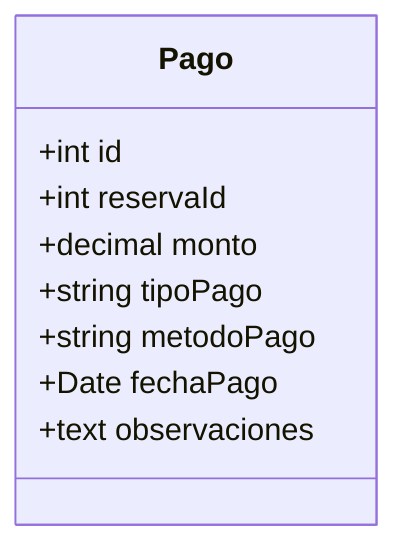
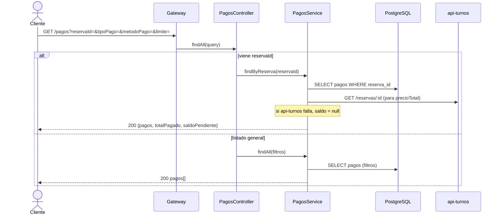
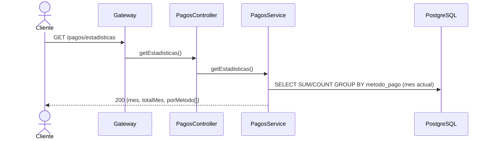
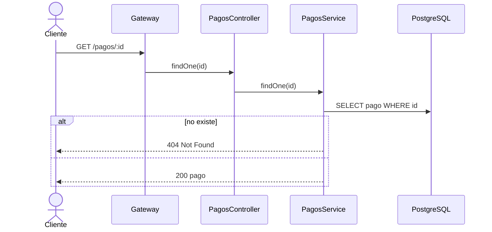
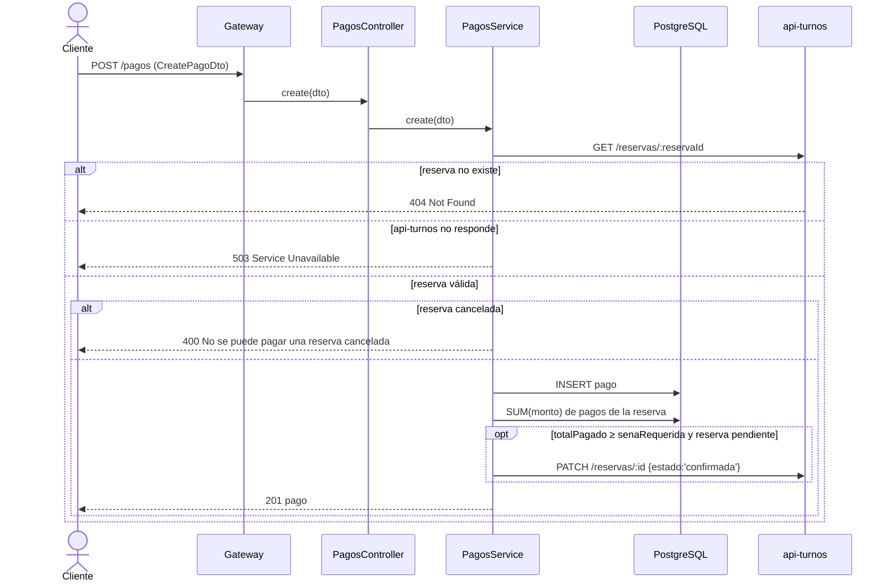

# api-pagos :3004

Microservicio de **pagos** de las reservas. Es el **dueño exclusivo** del recurso `pagos`.

- Base de datos: tabla `pagos`.
- Dependencia saliente: `api-turnos` (verificar la reserva y confirmarla tras el pago).
- Variables de entorno: `PORT`, `DATABASE_URL`, `TURNOS_URL`, `INTERNAL_SECRET`.
- Seguridad: `InternalAuthGuard` global → **403** si la request no trae `x-internal-secret` (no pasó
  por el gateway). Exentos: `OPTIONS` y `GET /health` (health check de Render → `{ status: 'ok' }`).

## Entidad

- `Pago.tipoPago`: `seña` · `saldo` · `completo` · `devolucion`
- `Pago.metodoPago`: `efectivo` · `tarjeta` · `transferencia`

## Endpoints

| Método | URL | Éxito | Descripción |
|--------|-----|-------|-------------|
| GET | `/pagos` | 200 | Listar pagos; con `?reservaId=` incluye saldo |
| GET | `/pagos/estadisticas` | 200 | Totales del mes por método de pago |
| GET | `/pagos/:id` | 200 | Obtener un pago |
| POST | `/pagos` | 201 | Registrar un pago |

> El orden de declaración importa: `/pagos/estadisticas` se define **antes** de `/pagos/:id` para
> que `estadisticas` no se interprete como un `:id`.

---

### `GET /pagos`  (lista general o pagos+saldo de una reserva)

### `GET /pagos/estadisticas`

### `GET /pagos/:id`

### `POST /pagos`  (registra el pago y confirma la reserva si cubre la seña)

