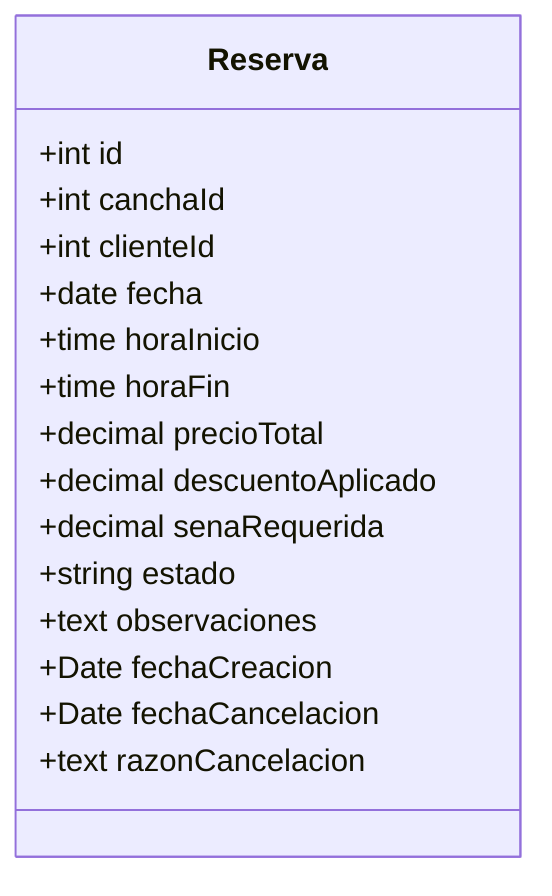
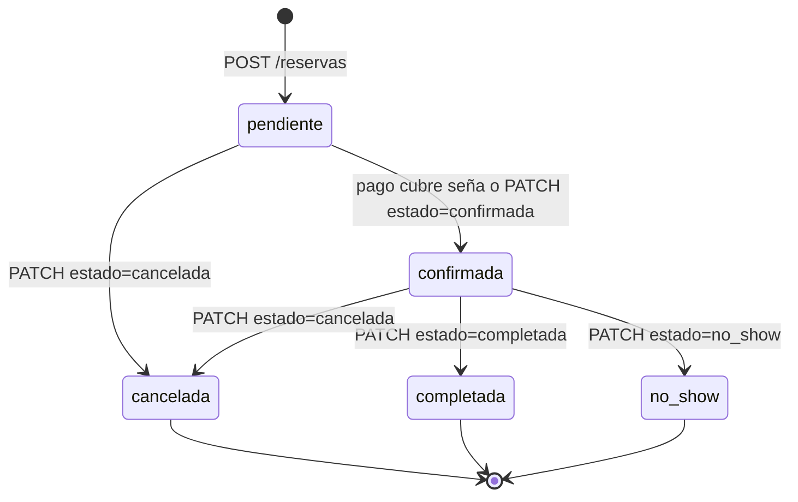
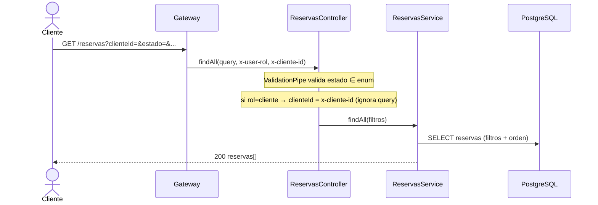
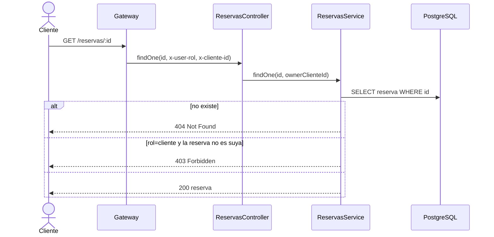
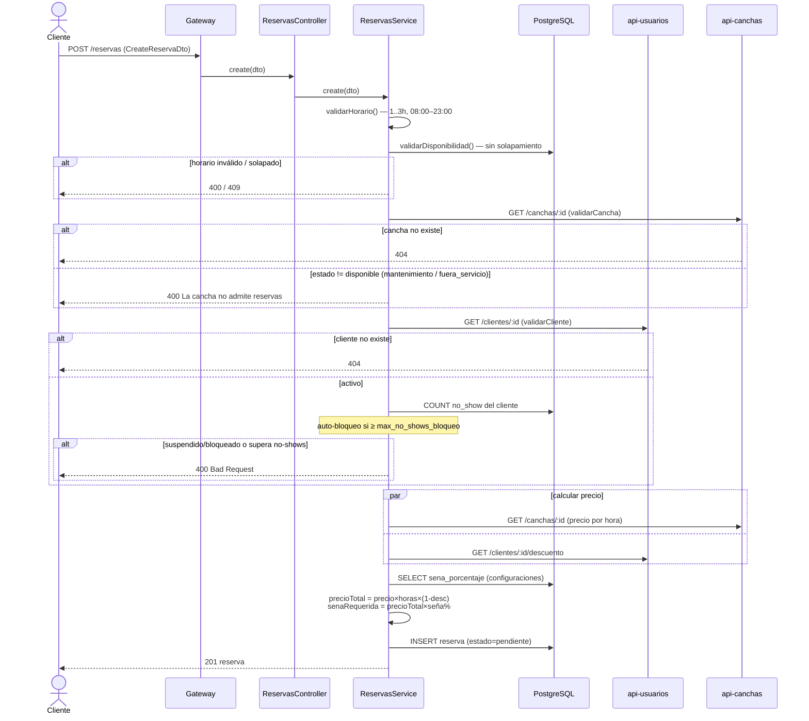
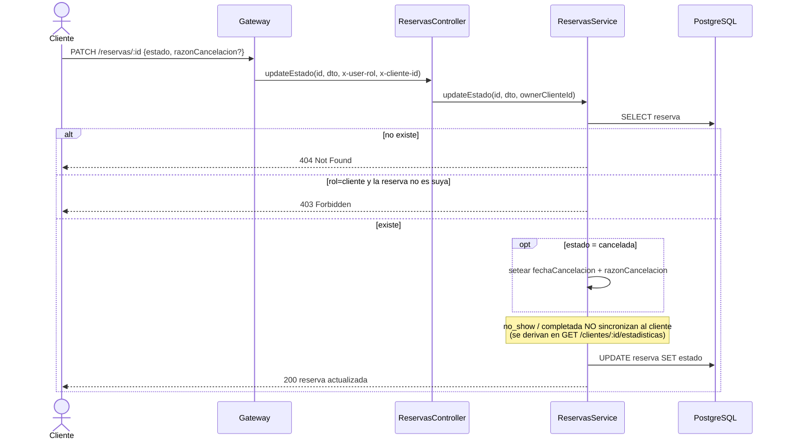
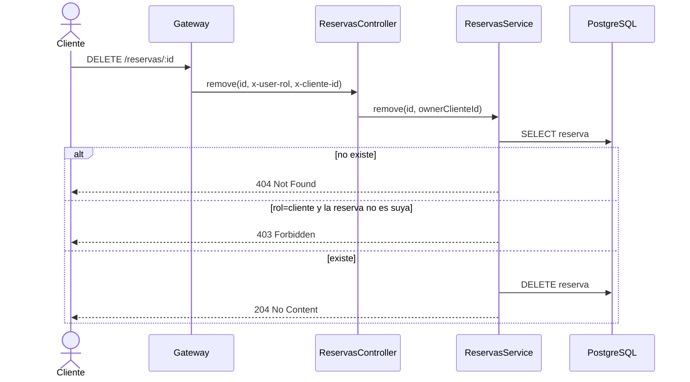
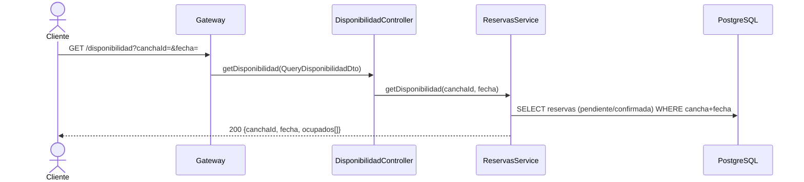

# api-turnos :3003

Microservicio de **reservas** y **disponibilidad horaria**. Concentra la lógica de negocio que
antes vivía en triggers de BD.

- Base de datos: tabla `reservas` + lectura de `configuraciones`.
- Dependencias salientes: `api-usuarios` (validar cliente, descuento) y `api-canchas` (precio).
- Consumido internamente por: `api-usuarios` (estadísticas + validar reservas al borrar cliente),
  `api-canchas` (reservas activas al inactivar/borrar cancha) y `api-pagos` (verificar/confirmar).
- Variables de entorno: `PORT`, `DATABASE_URL`, `USUARIOS_URL`, `CANCHAS_URL`,
  `SENA_PORCENTAJE_DEFAULT`, `HORAS_ANTICIPACION_MIN`, `DURACION_MAXIMA_HORAS`, `INTERNAL_SECRET`.
- Seguridad: `InternalAuthGuard` global → **403** si la request no trae `x-internal-secret` (no pasó
  por el gateway). Exentos: `OPTIONS` y `GET /health` (health check de Render → `{ status: 'ok' }`).

## Entidad

- `Reserva.estado`: `pendiente` · `confirmada` · `cancelada` · `completada` · `no_show`

> No almacena `sena_pagada` ni `pago_completo`: el estado de pago se deriva de api-pagos.

## Máquina de estados de una reserva

## Endpoints

| Método | URL | Éxito | Descripción |
|--------|-----|-------|-------------|
| GET | `/reservas` | 200 | Listar reservas (filtros validados) |
| GET | `/reservas/:id` | 200 | Obtener una reserva |
| POST | `/reservas` | 201 | Crear reserva |
| PATCH | `/reservas/:id` | 200 | Cambiar estado |
| DELETE | `/reservas/:id` | 204 | Eliminar reserva |
| GET | `/disponibilidad` | 200 | Horarios ocupados de una cancha en una fecha |

---

### `GET /reservas`

Filtros (query, validados por `QueryReservasDto`): `fecha`, `desde` (reservas con fecha ≥ ese día;
lo usan api-canchas/api-usuarios para verificar reservas a futuro), `canchaId`, `clienteId`,
`estado` (enum), `limite`.

> **Scope por dueño:** si `x-user-rol` = `cliente`, el controller fuerza `clienteId` con el
> `x-cliente-id` del token (inyectado por el gateway) e **ignora** el `clienteId` de la query, para
> que un cliente solo vea sus reservas. Un `admin` puede filtrar por cualquier `clienteId`.

### `GET /reservas/:id`

### `POST /reservas`  (creación con validaciones cross-service)

### `PATCH /reservas/:id`  (cambio de estado)

### `DELETE /reservas/:id`

### `GET /disponibilidad`

Recurso propio (controller `DisponibilidadController`) que reutiliza `ReservasService`. Query
requerido: `canchaId`, `fecha`.

