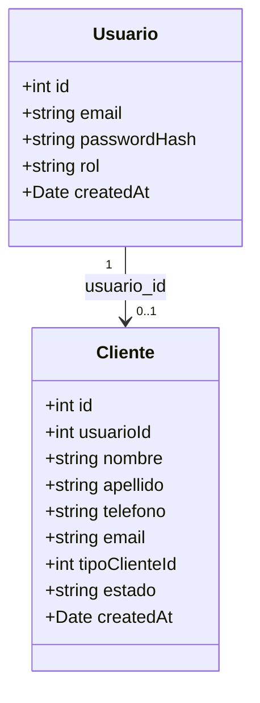
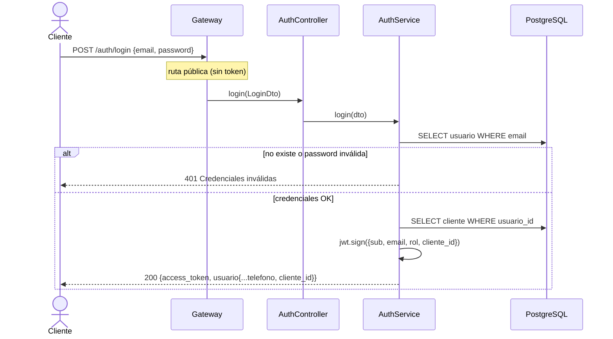
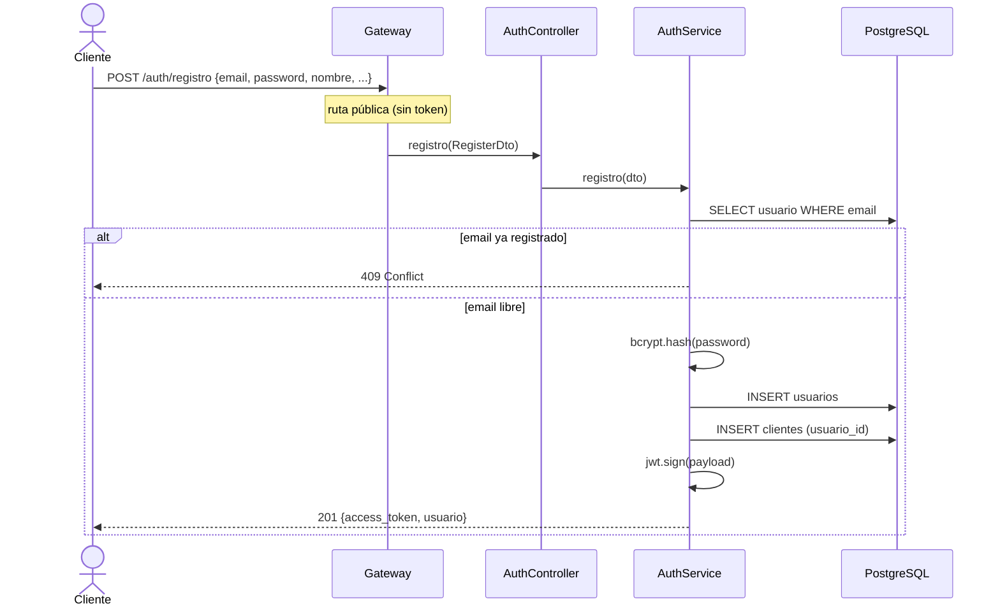
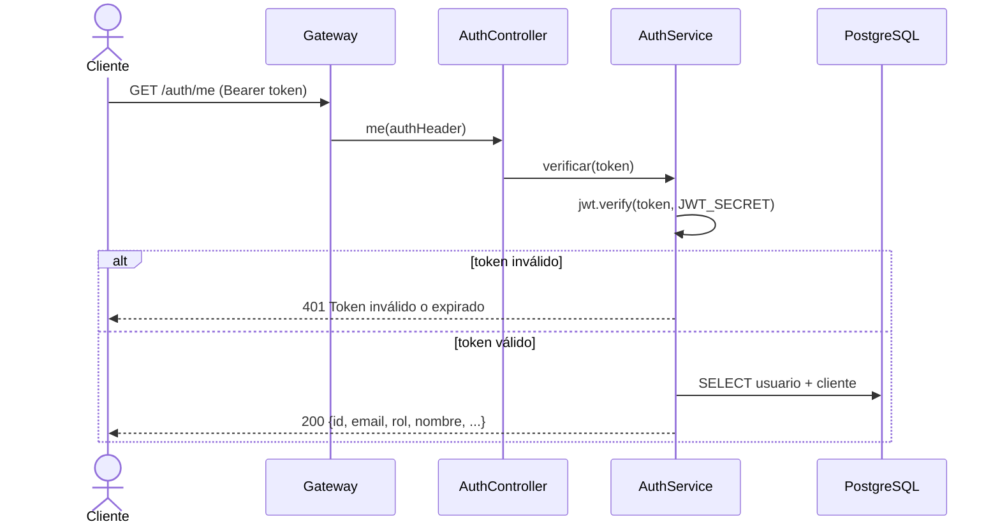
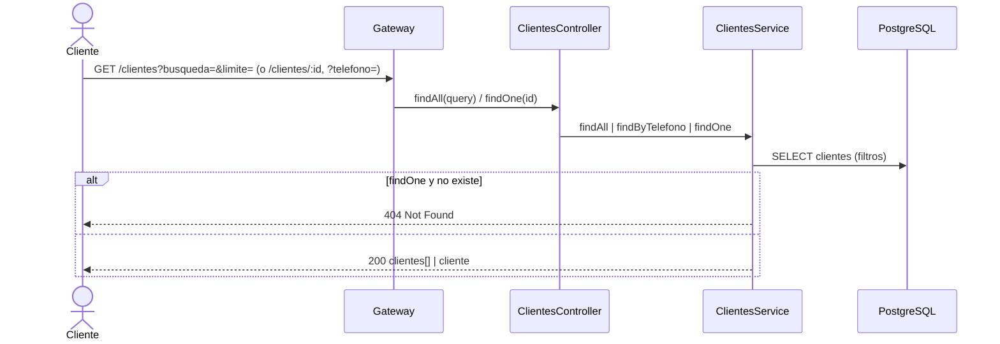
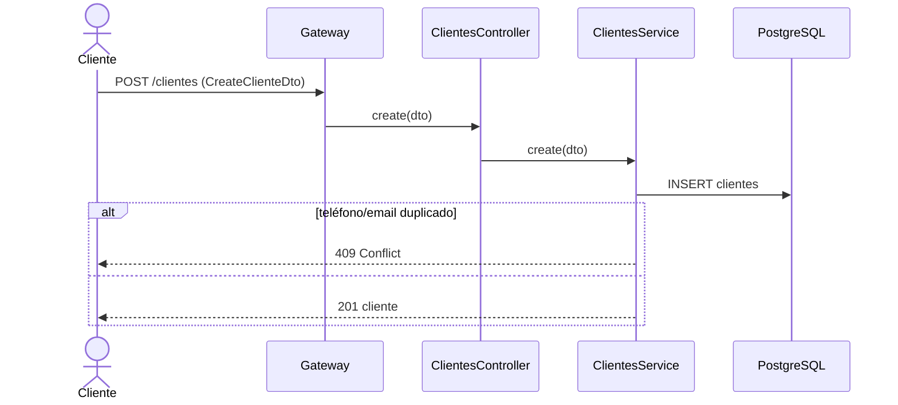
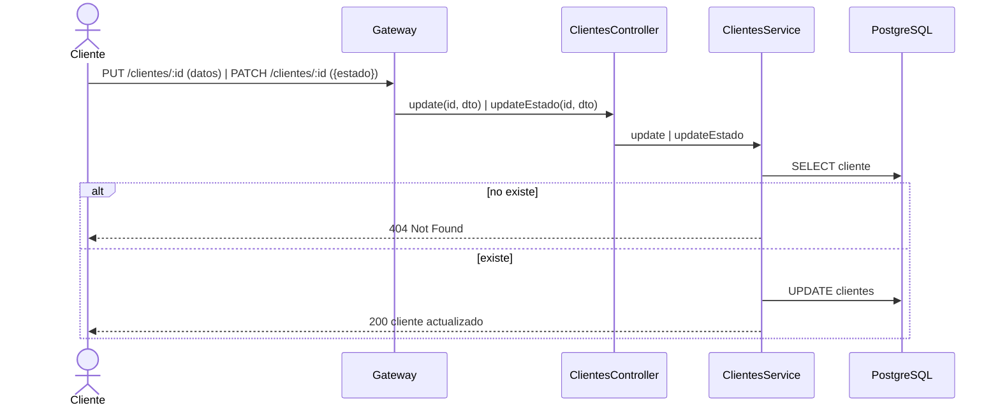
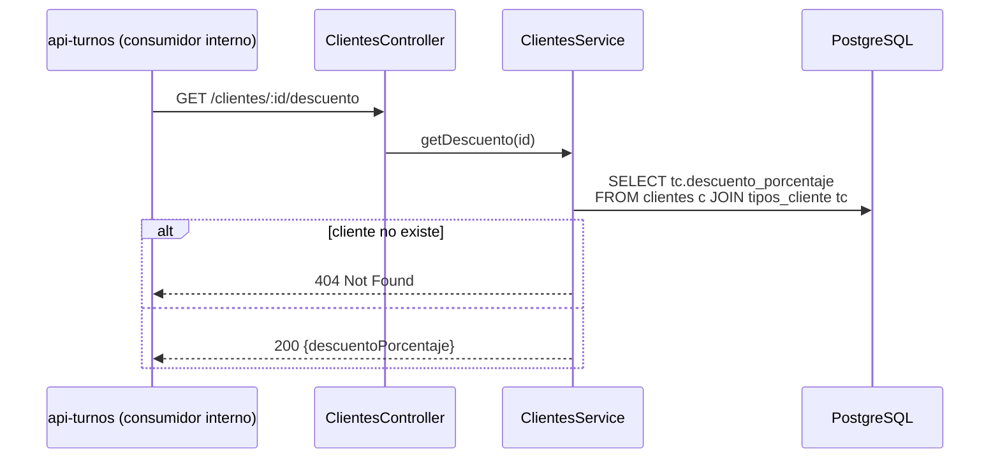
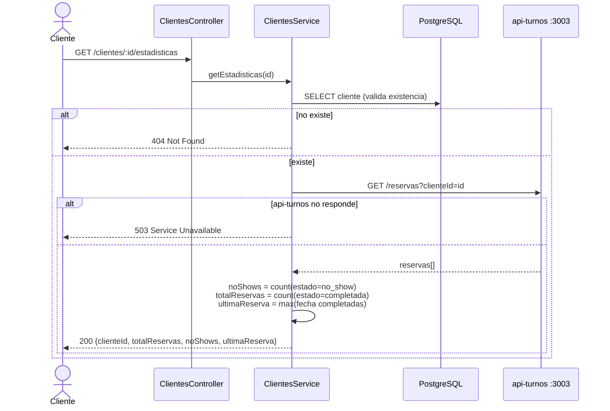
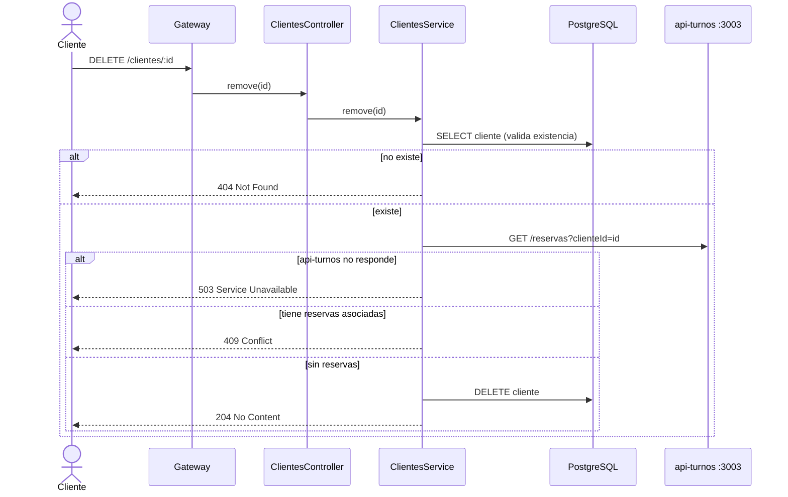

# api-usuarios :3001

Microservicio de **autenticación (JWT)** y **gestión de clientes**.

- Base de datos: tablas `usuarios`, `clientes`, `tipos_cliente`.
- Dependencia saliente: `api-turnos` (derivar estadísticas del cliente y validar reservas antes de borrar).
- Variables de entorno: `PORT`, `DATABASE_URL`, `JWT_SECRET`, `JWT_EXPIRES_IN`, `TURNOS_URL`, `INTERNAL_SECRET`.
- Seguridad: `InternalAuthGuard` global → **403** si la request no trae `x-internal-secret` (no pasó
  por el gateway). Exentos: `OPTIONS` y `GET /health` (health check de Render → `{ status: 'ok' }`).

## Entidades

- `Usuario.rol`: `cliente` · `empleado` · `admin`
- `Cliente.estado`: `activo` · `suspendido` · `bloqueado`

> Nota: `Cliente` **no** almacena `no_shows`, `total_reservas` ni `ultima_reserva` (datos derivados
> de las reservas, ver `GET /clientes/:id/estadisticas`).

## Endpoints

| Método | URL | Éxito | Descripción |
|--------|-----|-------|-------------|
| POST | `/auth/login` | 200 | Autenticar y obtener JWT |
| POST | `/auth/registro` | 201 | Registrar usuario + cliente |
| GET | `/auth/me` | 200 | Datos del usuario del token |
| GET | `/clientes` | 200 | Listar / buscar clientes |
| GET | `/clientes/:id` | 200 | Obtener un cliente |
| POST | `/clientes` | 201 | Crear cliente |
| PUT | `/clientes/:id` | 200 | Actualizar datos del cliente |
| PATCH | `/clientes/:id` | 200 | Actualizar estado del cliente |
| DELETE | `/clientes/:id` | 204 | Eliminar cliente (409 si tiene reservas) |
| GET | `/clientes/:id/descuento` | 200 | Descuento según tipo de cliente |
| GET | `/clientes/:id/estadisticas` | 200 | Estadísticas derivadas de reservas |

---

### `POST /auth/login`

### `POST /auth/registro`

### `GET /auth/me`

### `GET /clientes`  ·  `GET /clientes/:id`

### `POST /clientes`

### `PUT /clientes/:id`  ·  `PATCH /clientes/:id`

### `GET /clientes/:id/descuento`

### `GET /clientes/:id/estadisticas`  (dato derivado)

### `DELETE /clientes/:id`  (integridad cross-service)

No se puede borrar un cliente con reservas asociadas: como no hay FK entre `clientes` y `reservas`
(dueño: api-turnos), la verificación se hace por HTTP y se rechaza con **409**.

